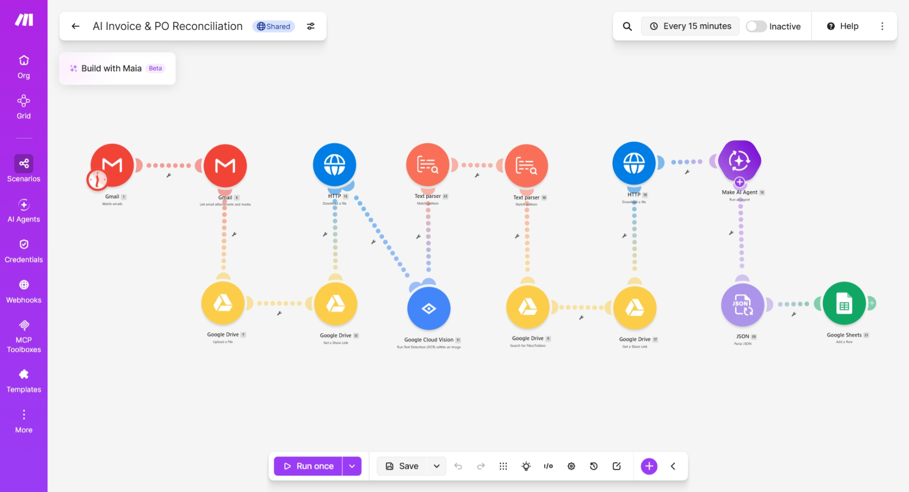

# AI Invoice & PO Reconciliation

A scenario that picks up supplier invoices received by email, finds the matching purchase order (PO) in Google Drive, asks an AI agent to compare them line by line, and logs the result (approved, discrepancy found or escalated) in Google Sheets.

▶️ **Video tutorial:** [watch on YouTube](https://www.youtube.com/watch?v=fF-biOX_5zc)

[](https://www.youtube.com/watch?v=fF-biOX_5zc)

## The scenario



```
Gmail (email with attachment) ──► Attachments ──► Google Drive (upload + share) ──► Download ──► Google Cloud Vision (OCR)
   ──► Find invoice # and PO # ──► Google Drive (find the PO + share) ──► Download ──► AI agent (compare) ──► Parse JSON ──► Google Sheets (add row)
```

## What it does

1. **Watch new emails** (Gmail): checks your inbox for emails with attachments.
2. **Get the invoice** (Gmail + Google Drive): saves the attachment to a Drive folder and downloads it.
3. **Read the invoice** (Google Cloud Vision): extracts its text with OCR.
4. **Find the numbers** (Text parser): looks for the invoice number (`INV-…-…`) and the PO number (`PO-…`) in the text.
5. **Find the PO** (Google Drive): searches a PO folder for a file whose name contains the PO number, and downloads it.
6. **Compare** (Make AI agent): sends both documents to the agent, which checks every line item and returns:
   - `status`: `APPROVED`, `DISCREPANCY_FOUND` or `ESCALATED`
   - `line_results`: each item with `match`, `semantic_match`, `discrepancy` or `escalated`, and a note
   - `reasoning`: a short summary

   The agent never approves a payment itself. It escalates any line it can't match with confidence, and ignores tax and shipping lines.
7. **Log the result** (Google Sheets): adds a row with the date, invoice number, PO number, status and reasoning.

> **The AI can make mistakes.** OCR can misread a number, and the agent can match the wrong lines or miss a discrepancy. The status is a first check, not a payment approval: always have a person verify the invoice against the PO before paying.

## Requirements

- A Make.com account with access to the **AI agent** module
- A Gmail account
- A Google account (Drive + Sheets)
- A Google Cloud project with the **Cloud Vision API** enabled

## Setup

**Google Drive**: two folders, one where invoices are saved and one with your POs. Each PO file name must contain its PO number (for example `PO-1042.pdf`).

**Google Sheet** with these headers in the first row:

| Header    | Filled with                     |
|-----------|---------------------------------|
| Date      | Date the invoice was processed  |
| Invoice # | Invoice number found by OCR     |
| PO #      | PO number found by OCR          |
| Status    | `status` from the AI            |
| Reasoning | `reasoning` from the AI         |

## Installation

1. Download [`AI Invoice & PO Reconciliation.blueprint.json`](AI%20Invoice%20%26%20PO%20Reconciliation.blueprint.json).
2. In Make, create a new scenario, open the **⋯** menu, choose **Import Blueprint** and select the file.
3. Reconnect each module to your own accounts:
   - **Gmail**: add your connection.
   - **Google Drive**: pick **your** invoice folder and **your** PO folder.
   - **Google Cloud Vision**: add your connection.
   - **AI agent**: check the model and connection available in your Make account.
   - **Google Sheets**: pick **your** spreadsheet and sheet.
4. If your invoice and PO numbers use a different format, change the patterns in the two **Text parser** modules.
5. In the **Parse JSON** module, rebuild the data structure if Make asks for it.
6. Click **Run once** and send yourself an email with a test invoice.
7. Turn on scheduling when you are happy with the result.

## Customizing

- **Matching rules**: edit the agent's system prompt in the AI agent module (role, decision rules, calibration rules).
- **Alerts**: add a router after Parse JSON to notify your accounting team when the status is `DISCREPANCY_FOUND` or `ESCALATED`.
- **Email filter**: limit the Gmail trigger to a label or a sender (for example your invoices mailbox) so you don't process every attachment.

## Privacy and security

- **⚠️ Files are shared publicly.** To download them, the scenario sets the invoice and the PO to "anyone with the link can view" in Google Drive. Anyone who gets the link can open them. Remove this sharing step (and download the files with the Google Drive module instead) if your invoices contain sensitive data.
- **Invoice and PO contents are sent to Google Cloud Vision and to the AI provider** for processing.
- **API keys and OAuth tokens stay in your Make connections** and are never exported in the blueprint.
- **Invoices are untrusted input.** A supplier could add text designed to trick the AI (prompt injection) into approving an invoice. Never pay on the AI's status alone.

## License

[MIT](LICENSE)
